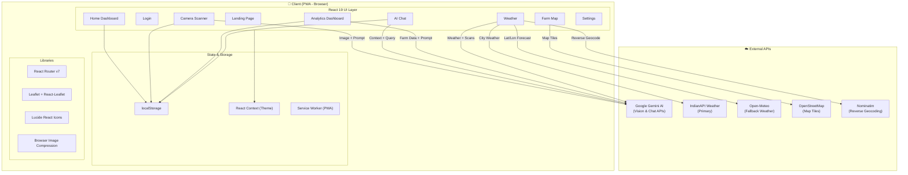

# 🌾 FarmBuddy — AI-Powered Smart Agriculture Diagnostic Platform

[](https://vite.dev/)
[](https://react.dev/)
[](https://tailwindcss.com/)
[](https://web.dev/progressive-web-apps/)
[](https://deepmind.google/technologies/gemini/)

> **Scan. Diagnose. Protect.** — Empowering Indian farmers with instant, AI-powered crop and livestock disease diagnostics, weather intelligence, and farm mapping in **22 scheduled Indian languages**. Works entirely client-side and offline-first.

---

## 📖 Overview

**FarmBuddy** is a Progressive Web Application (PWA) designed to bridge the gap between smallholder farmers and professional agricultural consultation. Annual crop losses in India exceed **₹50,000+ crore** due to delayed disease identification, combined with a severe shortage of agronomists and veterinarians.

FarmBuddy solves this by putting an **AI Agronomist and Veterinarian** directly in the farmer's pocket. Utilizing Google's **Gemini AI vision models**, FarmBuddy analyzes photos of crops and livestock, delivering localized diagnoses, severity assessments, treatment plans, and preventative care steps in the user's native language.

---

## ✨ Key Features

### 🔬 Multi-Domain AI Diagnostics
* **AI Camera Scanner:** Take a photo or upload an image of a crop leaf or livestock symptom for instant diagnostics in `< 3` seconds.
* **Dual Diagnosis Support:** Analyzes both **crops** (pests, nutrient deficiencies, diseases across 100+ species) and **livestock** (cattle, poultry, goats, sheep, etc.).
* **Triage Metrics:** Provides a health score percentage, severity indicators (Critical, Moderate, Healthy), and urgency ratings (Immediate action, Within 24 hours, Routine care).
* **Differential Diagnoses:** Displays the top 3 potential conditions ranked by confidence level.

### 📊 Farm Analytics & Tracking
* **Growth & Yield Tracking:** Logs daily metrics such as milk yield (liters), crop yield (kg), plant height (cm), and animal weight (kg).
* **Historical Trend Charts:** Visualizes progress and health scores over time using responsive graphs.
* **AI Feed & Fertilizer Planner:** Generates customized crop-care schedules and animal feeding plans using Gemini AI based on historical logs.

### 🌦️ Weather & Intelligent Alerts
* **Hyperlocal Weather:** Fetches live weather conditions and a 7-day forecast via the **IndianAPI** (with a fail-safe fallback to **Open-Meteo**).
* **AI Smart Alerts:** The system correlates local weather patterns (e.g., high humidity, incoming heavy rain) with the farmer's scan history to proactively warn them of potential pest outbreaks or disease spreads.

### 💬 Voice-Enabled AI Chat
* **Context-Aware Assistant:** Chat with FarmBuddy AI regarding specific farm management advice. The assistant retains context from the farmer's profile, scan history, and growth logs.
* **Hands-Free Speech-to-Text:** Built-in Web Speech API voice input allows farmers to speak their queries in their native language.

### 🗺️ Farm Mapping & Management
* **Interactive Leaflet Map:** Centered on the farmer's current GPS location.
* **Geographical Markers:** Drop markers on specific fields, name them, specify the crop variety, and check field health status, which updates automatically (color-coded green or red) based on the latest scan history.

### 🌐 Extreme Accessibility
* **22 Scheduled Indian Languages:** Full localization of the app UI and real-time translation of all AI outputs into 22 Indian languages.
* **PWA & Offline-First:** Fully installable as a native app on Android, iOS, or desktop. Caches OSM map tiles, fonts, icons, and weather data via Service Workers.
* **Privacy by Design:** Near-zero running costs. All logs, scans, and chats are saved in the client's `localStorage` and never leave the device. Farmers provide their own Gemini API key in settings.

---

## 🛠️ Architecture

The app uses a client-side architecture that eliminates server-side hosting costs and ensures privacy.



---

## 🧰 Tech Stack

* **Core Framework:** React 19, Vite 7, React Router v7
* **Styling:** TailwindCSS v3 (Custom color tokens for dark/light themes)
* **AI:** Google Gemini API (via `@google/generative-ai`)
* **Mapping:** Leaflet 1.9 & React-Leaflet 5
* **Weather:** IndianAPI & Open-Meteo REST API
* **Icons:** Lucide React & Iconify
* **Image Management:** Browser Image Compression (prevents large image payloads before sending to Gemini API)

---

## ⚡ Getting Started

### Prerequisites
Make sure you have [Node.js](https://nodejs.org/) (v18.x or higher) and `npm` installed.

### Installation

1. **Clone the Repository:**
   ```bash
   git clone https://github.com/souravranjanmirdha-sudo/FarmBuddy.git
   cd FarmBuddy
   ```

2. **Install Dependencies:**
   ```bash
   npm install
   ```

3. **Run the Development Server:**
   ```bash
   npm run dev
   ```
   Open your browser and navigate to `http://localhost:5173`.

4. **Build for Production (PWA):**
   ```bash
   npm run build
   ```
   To test the built project with PWA capabilities, run:
   ```bash
   npm run preview
   ```

---

## ⚙️ Configuration & API Setup

FarmBuddy works right out of the box using mockup data, but to access AI and weather diagnostics:

1. **Get a Gemini API Key:**
   Go to [Google AI Studio](https://aistudio.google.com/) and create a free API Key.
2. **Configure in the App:**
   Inside FarmBuddy, navigate to **Settings (⚙️)**, input your API Key, and select your preferred Indian language. The key is securely saved directly in your browser's local storage and is never uploaded to any external server (except when calling Google's API directly from the client).

---

## 📱 PWA & Offline Support Details

To ensure reliability in rural areas with poor connectivity, FarmBuddy caches static assets and external data:

* **Static Assets:** Service worker caches JavaScript bundles, Tailwind styles, and system assets.
* **Map Tiles:** Map view caches OpenStreetMap tiles dynamically (`CacheFirst` strategy, expires in 7 days) as you browse.
* **Weather Cache:** Caches weather responses (`StaleWhileRevalidate` strategy, expires in 30 minutes).
* **Reverse Geocoding:** Nominatim geocoder requests are cached locally for 24 hours.
* **Google Fonts:** Caches typography stylesheets and webfont files.

---

## 📂 Project Structure

```text
FarmBuddy/
├── public/                # Favicons, Web App Manifest & static assets
├── src/
│   ├── assets/            # App-wide images (hero.png) and logos
│   ├── components/        # Shared components (Bottom Nav, Theme toggles)
│   ├── pages/             # Dashboard, Scanner, Chat, Map, Settings pages
│   ├── utils/             # Helper dictionaries, i18n support, Gemini client
│   ├── App.jsx            # Main app router and layout setup
│   ├── index.css          # Tailwind directives & CSS design systems
│   └── main.jsx           # App bootstrapping
├── package.json
├── tailwind.config.js     # Custom agricultural color system definitions
└── vite.config.js         # PWA and Workbox runtime cache configurations
```

---

## 🛣️ Roadmap & Future Enhancements

* [ ] **Firebase Authentication:** Replace local username authentication with Google & Phone OTP login.
* [ ] **Cloud Sync:** Synchronize farm data and scan histories across multiple devices.
* [ ] **Regional Mandi Prices:** Live commodity prices from nearest APMC markets.
* [ ] **WhatsApp Bot:** Access AI diagnostics via a WhatsApp contact.
* [ ] **Satellite Health Monitoring:** Integrate NDVI indices for macro-crop inspection.

---

## 📄 License

This project is licensed under the MIT License. See [LICENSE](LICENSE) for more details.

---

👨‍🌾 *FarmBuddy — Cultivating Technology for Sustainable Farming.*
